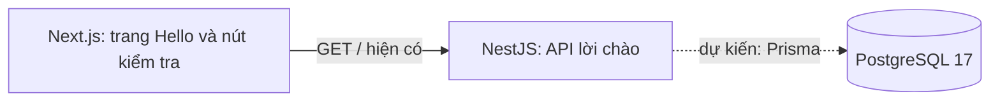

# BrewLite

BrewLite là đồ án Công nghệ phần mềm của nhóm năm sinh viên. Mục tiêu là xây dựng
ứng dụng web đặt đồ uống để khách nhận tại quầy, có thanh toán **mô phỏng**.
Dự án không xử lý tiền thật hoặc giao hàng.

README này hướng dẫn chạy **mã nguồn hiện có**. Thiết kế, phân công và tiến độ
chi tiết được lưu trong [`docs/`](docs/PROJECT_CONTEXT.md); tài liệu kế hoạch
không đồng nghĩa chức năng đã triển khai hoặc được nghiệm thu.

## Hiện trạng chức năng

| Mức độ | Nội dung |
| --- | --- |
| Đã có trong mã nguồn | Trang Next.js “Hello BrewLite!” với nút **Kiểm tra kết nối backend**; NestJS `GET /` trả `Hello from BrewLite backend!`; unit test và E2E test cho lời chào; cấu hình PostgreSQL trong Docker Compose. |
| Mới có khung hoặc thiết kế | `ProductsModule` là module rỗng. Kiến trúc modular monolith và kết nối dữ liệu qua Prisma được mô tả trong tài liệu, nhưng Prisma chưa được tích hợp. |
| Dự kiến | Menu, chi tiết đồ uống, size/topping, giỏ hàng, tài khoản, đơn hàng, tồn kho, khuyến mãi, điểm thưởng và thanh toán giả lập. Chưa có căn cứ từ code để hướng dẫn sử dụng các chức năng này. |

Test hiện có chỉ kiểm tra API lời chào, chưa kiểm chứng nghiệp vụ đặt đồ uống.
Xem [Project Roadmap](docs/PROJECT_ROADMAP.md) để theo dõi 24 bước và minh chứng.

## Công nghệ và kiến trúc

| Thành phần | Đã xác minh từ repository |
| --- | --- |
| Frontend | Next.js 16.3.6, React 19.2.8, TypeScript, Tailwind CSS 4 |
| Backend | NestJS 11, TypeScript; hiện có API lời chào và module Products rỗng |
| Database | Docker Compose khai báo `postgres:17-alpine`, healthcheck và named volume `postgres_data` |
| ORM | Prisma **dự kiến**; chưa có package, schema, migration hoặc kết nối backend–database |
| Công cụ | npm với ba lockfile riêng; Git/GitHub; Docker Compose hiện chỉ có service `db` |

Thiết kế đích là một frontend Next.js gọi REST API/JSON của backend NestJS.
Backend chia module nghiệp vụ trong cùng một ứng dụng (**modular monolith**);
theo thiết kế, backend sẽ dùng Prisma để truy cập PostgreSQL. Frontend không
truy cập database trực tiếp.



Sơ đồ phân biệt kết nối API đang có (nét liền) với truy cập database dự kiến
(nét đứt). Hiện Compose **chỉ chạy PostgreSQL**; frontend và backend chạy bằng
npm trên máy. Repository chưa có Dockerfile để đóng gói hai ứng dụng.

## Cấu trúc repository

| Đường dẫn | Vai trò |
| --- | --- |
| `frontend/src/app/` | Trang Next.js và nút kiểm tra API |
| `backend/src/` | Ứng dụng NestJS, `GET /` và module Products rỗng |
| `backend/test/` | E2E test cho API lời chào |
| `docs/` | Bối cảnh, kiến trúc, lộ trình, phân công và truy vết yêu cầu |
| `docker-compose.yml` | PostgreSQL service `db`, healthcheck và volume dữ liệu |
| `package.json` | Script chạy đồng thời và build frontend/backend |
| `.env.example`, `backend/.env.example`, `frontend/.env.example` | Ba mẫu biến môi trường |

Gốc repository, `backend/` và `frontend/` có `package.json` cùng
`package-lock.json` riêng; cần cài dependencies ở cả ba vị trí.

## Công cụ cần cài

- [Node.js](https://nodejs.org/en/download) và npm đi kèm: khuyến nghị bản
  **Node.js 24 LTS**. Repository chưa khóa Node/npm bằng `engines` hoặc `.nvmrc`;
  lockfile của script chạy chung chứa `concurrently` yêu cầu Node `>=22`.
- [Git](https://git-scm.com/downloads) để clone repository; không có phiên bản
  Git tối thiểu được khai báo.
- [Docker và Docker Compose](https://docs.docker.com/compose/install/) để chạy
  PostgreSQL. Cần lệnh `docker compose` và Docker daemon/Desktop đang hoạt động;
  repository không khóa phiên bản Docker/Compose.

Sau khi cài, mở **terminal mới** và kiểm tra `node --version`, `npm --version`,
`git --version`, `docker --version`, `docker compose version` và `docker info`.
`docker info` chỉ xác nhận daemon có thể truy cập, không khởi động dịch vụ.

## Windows 10/11 — PowerShell

1. Cài Node.js từ [trang Node.js](https://nodejs.org/en/download),
   [Git for Windows](https://git-scm.com/download/win) và
   [Docker Desktop for Windows](https://docs.docker.com/desktop/setup/install/windows-install/).
   Làm theo yêu cầu WSL 2 của Docker Desktop nếu trình cài đặt thông báo; mở
   Docker Desktop và chờ ứng dụng sẵn sàng.
2. Mở **PowerShell mới** và kiểm tra công cụ:

Ví dụ dùng `npm.cmd` để gọi npm trực tiếp, kể cả khi PowerShell chặn script
`npm.ps1` theo Execution Policy.

```powershell
node --version
npm.cmd --version
git --version
docker --version
docker compose version
docker info
```

3. Clone, tạo đủ ba file môi trường nếu chưa có và cài dependencies:

```powershell
git clone https://github.com/NguyenKhanhHungDev/Swe_project.git
Set-Location Swe_project
if (-not (Test-Path .env)) { Copy-Item .env.example .env }
if (-not (Test-Path backend/.env)) { Copy-Item backend/.env.example backend/.env }
if (-not (Test-Path frontend/.env.local)) { Copy-Item frontend/.env.example frontend/.env.local }
npm.cmd ci
npm.cmd --prefix backend ci
npm.cmd --prefix frontend ci
```

Kiểm tra ba file môi trường theo mục [Cấu hình](#cấu-hình-môi-trường-và-postgresql)
trước khi chạy. Mở ba cửa sổ PowerShell, mỗi cửa sổ ở thư mục `Swe_project`:

```powershell
# Terminal 1 — PostgreSQL
docker compose config --quiet
docker compose up -d --wait db
docker compose ps
```

```powershell
# Terminal 2 — backend
npm.cmd --prefix backend run start:dev
```

```powershell
# Terminal 3 — frontend
npm.cmd --prefix frontend run dev -- --port 3000
```

Dừng backend và frontend bằng `Ctrl+C` tại Terminal 2/3. Sau đó, tại thư mục
gốc dự án chạy `docker compose stop db` để dừng database mà giữ volume.

## Linux — Bash

Cài [Node.js 24 LTS](https://nodejs.org/en/download) và npm theo hướng dẫn
chính thức; nếu dùng gói của bản phân phối, kiểm tra phiên bản thực tế trước khi
chạy `npm ci`. Cài Git theo bản phân phối
([hướng dẫn Git](https://git-scm.com/install/linux.html)). Chọn **một** lệnh
phù hợp với máy của bạn:

```bash
# Ubuntu/Debian
sudo apt update
sudo apt install git
```

```bash
# Fedora
sudo dnf install git
```

```bash
# Arch/EndeavourOS
sudo pacman -S git
```

Cài Docker Engine **và Compose plugin** theo hướng dẫn riêng cho
[Ubuntu](https://docs.docker.com/engine/install/ubuntu/),
[Debian](https://docs.docker.com/engine/install/debian/) hoặc
[Fedora](https://docs.docker.com/engine/install/fedora/). Với Arch/EndeavourOS,
tham khảo [ArchWiki Docker](https://wiki.archlinux.org/title/docker) để cài
gói `docker` và `docker-compose`, rồi khởi động `docker.service`. Cách cài và
quyền truy cập daemon khác nhau theo bản phân phối; kiểm tra bằng `docker info`
và xử lý quyền theo đúng hướng dẫn Docker của hệ điều hành, không giả định daemon
đã chạy.

Mở terminal Bash mới và xác minh:

```bash
node --version
npm --version
git --version
docker --version
docker compose version
docker info
```

Clone, tạo file môi trường khi chưa tồn tại và cài dependencies:

```bash
git clone https://github.com/NguyenKhanhHungDev/Swe_project.git
cd Swe_project
[ -f .env ] || cp .env.example .env
[ -f backend/.env ] || cp backend/.env.example backend/.env
[ -f frontend/.env.local ] || cp frontend/.env.example frontend/.env.local
npm ci
npm --prefix backend ci
npm --prefix frontend ci
```

Kiểm tra [cấu hình](#cấu-hình-môi-trường-và-postgresql), rồi mở ba terminal Bash
tại thư mục `Swe_project`:

```bash
# Terminal 1 — PostgreSQL
docker compose config --quiet
docker compose up -d --wait db
docker compose ps
```

```bash
# Terminal 2 — backend
npm --prefix backend run start:dev
```

```bash
# Terminal 3 — frontend
npm --prefix frontend run dev -- --port 3000
```

Dừng Terminal 2/3 bằng `Ctrl+C`, rồi chạy `docker compose stop db` ở thư mục
gốc để dừng PostgreSQL mà không xóa dữ liệu.

## macOS — Terminal/zsh

Cài [Node.js 24 LTS](https://nodejs.org/en/download),
[Git](https://git-scm.com/download/mac) và
[Docker Desktop for Mac](https://docs.docker.com/desktop/setup/install/mac-install/)
theo hướng dẫn cho máy Mac của bạn. Mở Docker Desktop và chờ daemon sẵn sàng.
Mở Terminal/zsh mới để kiểm tra:

```zsh
node --version
npm --version
git --version
docker --version
docker compose version
docker info
```

Clone, tạo file môi trường khi chưa tồn tại và cài dependencies:

```zsh
git clone https://github.com/NguyenKhanhHungDev/Swe_project.git
cd Swe_project
[ -f .env ] || cp .env.example .env
[ -f backend/.env ] || cp backend/.env.example backend/.env
[ -f frontend/.env.local ] || cp frontend/.env.example frontend/.env.local
npm ci
npm --prefix backend ci
npm --prefix frontend ci
```

Kiểm tra [cấu hình](#cấu-hình-môi-trường-và-postgresql), rồi mở ba Terminal/zsh
tại thư mục `Swe_project`:

```zsh
# Terminal 1 — PostgreSQL
docker compose config --quiet
docker compose up -d --wait db
docker compose ps
```

```zsh
# Terminal 2 — backend
npm --prefix backend run start:dev
```

```zsh
# Terminal 3 — frontend
npm --prefix frontend run dev -- --port 3000
```

Dừng Terminal 2/3 bằng `Ctrl+C`, rồi chạy `docker compose stop db` ở thư mục
gốc. Không dùng `docker compose down -v` cho việc dừng thông thường vì `-v`
xóa named volume dữ liệu.

## Cấu hình môi trường và PostgreSQL

Ba file mẫu đều có trong repository. Các lệnh sao chép phía trên **không ghi
đè** file môi trường đã tồn tại; không đưa giá trị bí mật vào commit hoặc issue.

| File cần tạo | File mẫu | Biến cần kiểm tra |
| --- | --- | --- |
| `.env` | `.env.example` | `POSTGRES_DB`, `POSTGRES_USER`, `POSTGRES_PASSWORD`, `POSTGRES_PORT` |
| `backend/.env` | `backend/.env.example` | `PORT`, `FRONTEND_URL`, `DATABASE_URL` |
| `frontend/.env.local` | `frontend/.env.example` | `NEXT_PUBLIC_API_URL` |

Theo file mẫu, PostgreSQL trong container dùng cổng `5432`; Compose công bố
cổng máy `127.0.0.1:5433` (hoặc giá trị `POSTGRES_PORT` bạn đặt). Backend chạy
trên máy nên URL database trong file mẫu hướng tới `localhost:5433`, nhưng
**backend hiện chưa sử dụng `DATABASE_URL` để kết nối database**. Nếu đổi cổng
database, đồng bộ `POSTGRES_PORT` và `DATABASE_URL`; nếu đổi cổng backend, đồng
bộ `PORT` và `NEXT_PUBLIC_API_URL`. Đổi cổng frontend cần sửa đối số `--port 3000`
trong lệnh Next.js và cập nhật `FRONTEND_URL` cho CORS.

Compose chỉ khai báo service `db` cùng healthcheck và named volume
`postgres_data`; không có frontend/backend service hoặc network riêng được
khai báo. Docker Compose tạo network mặc định. Đổi thông tin khởi tạo trong
`.env` không tự cập nhật database đã tồn tại trong volume. Để xem trạng thái
và log (trên cả ba hệ điều hành):

```text
docker compose ps
docker compose logs --tail=100 db
```

`NEXT_PUBLIC_API_URL` được đưa tới trình duyệt: không đặt mật khẩu hoặc bí mật
vào biến `NEXT_PUBLIC_`. Khởi động lại ứng dụng sau khi sửa file môi trường.

## Kiểm tra và sử dụng ứng dụng hiện có

Khi ba terminal đã chạy, mở <http://localhost:3000>. Trang hiển thị
**Hello BrewLite!**; bấm **Kiểm tra kết nối backend**. Nếu backend phản hồi,
giao diện hiển thị `Backend phản hồi: Hello from BrewLite backend!`.
Mở <http://localhost:3001/> để kiểm tra trực tiếp `GET /`; nội dung trả về là
`Hello from BrewLite backend!`. Đây là route lời chào, **không phải health
endpoint chuyên dụng**. Backend hiện trả lời route này mà không cần truy vấn
PostgreSQL. Dùng `docker compose ps` để kiểm tra riêng database đã `healthy`.

Menu, đặt hàng và thanh toán chưa có luồng chạy được để hướng dẫn người dùng.
Không dùng kết quả trang Hello để suy ra các chức năng đó đã hoàn thành.

## Lint, test và build

Sau khi cài dependencies, chạy từ thư mục gốc. Các lệnh này được đối chiếu với
`package.json` nhưng **chưa được chạy trong lần cập nhật README này**.
Trên Linux/macOS (Bash/zsh):

```bash
npm --prefix frontend run lint
npm --prefix backend test -- --runInBand
npm --prefix backend run test:e2e -- --runInBand
npm run build
```

Trên Windows PowerShell, dùng `npm.cmd` để tránh lỗi Execution Policy:

```powershell
npm.cmd --prefix frontend run lint
npm.cmd --prefix backend test -- --runInBand
npm.cmd --prefix backend run test:e2e -- --runInBand
npm.cmd run build
```

Frontend chưa có script `test`. Unit test và E2E test backend hiện chỉ kiểm tra
lời chào. Script lint backend (`npm --prefix backend run lint` trên Bash/zsh hoặc
`npm.cmd --prefix backend run lint` trên PowerShell) có `--fix`, nên **có thể sửa
file mã nguồn**; chỉ chạy khi muốn áp dụng sửa tự động và kiểm tra diff sau đó.
`npm run build` build backend rồi frontend. Nếu build gặp lỗi do server phát
triển đang dùng thư mục đầu ra, dừng server và thử lại. Không có lệnh Prisma
migration/seed trong repository để chạy ở giai đoạn hiện tại.

## Xử lý lỗi thường gặp

| Hiện tượng | Cách kiểm tra |
| --- | --- |
| `node`, `npm`/`npm.cmd`, `git` hoặc `docker` không nhận diện | Hoàn tất cài đặt, mở terminal mới và chạy lại các lệnh `--version`; dùng `npm.cmd --version` trên PowerShell, `npm --version` trên Bash/zsh. Với Docker, kiểm tra Desktop/daemon. |
| `docker info` không kết nối được | Mở Docker Desktop (Windows/macOS) hoặc khởi động daemon theo hướng dẫn bản phân phối Linux; kiểm tra quyền truy cập Docker. |
| Compose báo thiếu `POSTGRES_*` | Kiểm tra `.env` ở gốc đã tạo từ `.env.example` và có đủ biến được yêu cầu. |
| Cổng `3000` đã được dùng | Dừng tiến trình chiếm cổng hoặc sửa đối số `--port 3000` trong lệnh Next.js sang cổng mới; mở frontend ở cổng đó và cập nhật `FRONTEND_URL` trong `backend/.env`. Chỉ đổi biến môi trường không đổi cổng Next.js. |
| Cổng `3001` hoặc `5433` đã được dùng | Nếu đổi cổng backend, đồng bộ `PORT` và `NEXT_PUBLIC_API_URL`; nếu đổi cổng PostgreSQL, đồng bộ `POSTGRES_PORT` và `DATABASE_URL`. |
| `concurrently`, `nest` hoặc `next` không tìm thấy | Cài lại dependencies ở gốc, backend và frontend bằng ba lệnh `ci` trong hướng dẫn hệ điều hành tương ứng: `npm.cmd` trên PowerShell, `npm` trên Bash/zsh. |
| Nút kiểm tra backend báo lỗi | Mở trực tiếp `http://localhost:3001/`; kiểm tra Terminal 2, `NEXT_PUBLIC_API_URL` và CORS `FRONTEND_URL`, rồi khởi động lại frontend/backend. |
| Database chưa `healthy` | Xem `docker compose ps` và `docker compose logs --tail=100 db`; backend Hello vẫn có thể hoạt động vì chưa truy vấn DB. |
| `npm ci` hoặc `npm.cmd ci` báo lockfile không khớp | Đối chiếu `package.json` với lockfile cùng thư mục; nhờ người cập nhật dependency sửa cả hai file. |

## Nhóm và tài liệu

| Thành viên | Phạm vi phụ trách theo kế hoạch |
| --- | --- |
| Hưng (leader) | Products, ERD, PrismaService, Docker và tích hợp |
| Khoa | Auth, Users, RBAC và Inventory |
| Huy | Cart, Promotions, Loyalty và tổng hợp kiểm thử |
| Phát | Orders, schema/migration/seed và điều phối Figma |
| Thắng | Checkout, Payments, Deployment Diagram và E2E |

Đây là **phân công**, không phải danh sách tính năng đã hoàn thành. Chi tiết
người chủ trì và người trực tiếp thực hiện xem
[Team Assignments](docs/TEAM_ASSIGNMENTS.md).

- [Project Context](docs/PROJECT_CONTEXT.md): bối cảnh, phạm vi và hiện trạng.
- [Project Roadmap](docs/PROJECT_ROADMAP.md): 24 bước, trạng thái tham khảo và minh chứng.
- [Requirements Traceability](docs/REQUIREMENTS_TRACEABILITY.md): truy vết 10 Task của đề bài.
- [Architecture](docs/ARCHITECTURE.md): kiến trúc và ranh giới module.
- [Team Assignments](docs/TEAM_ASSIGNMENTS.md): phân công chi tiết của nhóm.

Tài liệu gốc Project Scope, SRS, User Stories, Acceptance Criteria, Business
Rules, Use Case Diagram và Use Case Description chưa có trong repository; cần
bổ sung hoặc liên kết nguồn chính thức khi nhóm cung cấp.

## Phần Huy — nhánh local `Huy`

Phạm vi đang chuẩn bị: **Bước 13–14, Cart / Promotions / Loyalty**. Các file
dưới đây là thiết kế để review, chưa phải chức năng Next.js/NestJS đã triển khai.
Nhánh `Huy` được tạo từ main `66fb1be`; chưa commit/push hoặc mở PR. Nội dung
và các file vốn có của nhóm được giữ nguyên; phần mới của Huy được bổ sung riêng.

| Đầu ra | Mã nguồn | Ảnh |
|---|---|---|
| Đặc tả Cart, mua ngay | [cart.md](docs/api/cart.md) | — |
| Đặc tả Promotions/Loyalty | [promotions-loyalty.md](docs/api/promotions-loyalty.md) | — |
| Thêm món / Mua ngay | [01-add-item.puml](docs/diagrams/sequence/cart/01-add-item.puml) | [SVG](docs/diagrams/sequence/cart/01-add-item.svg) |
| Sửa / Xóa món | [02-update-remove-item.puml](docs/diagrams/sequence/cart/02-update-remove-item.puml) | [SVG](docs/diagrams/sequence/cart/02-update-remove-item.svg) |
| Áp dụng mã | [01-apply-voucher.puml](docs/diagrams/sequence/promotions-loyalty/01-apply-voucher.puml) | [SVG](docs/diagrams/sequence/promotions-loyalty/01-apply-voucher.svg) |
| Kiểm tra điểm | [02-use-loyalty-points.puml](docs/diagrams/sequence/promotions-loyalty/02-use-loyalty-points.puml) | [SVG](docs/diagrams/sequence/promotions-loyalty/02-use-loyalty-points.svg) |

Sơ đồ dùng PlantUML, đen trắng, có thanh kích hoạt và 4–5 cột. Chi tiết
validation/transaction nằm trong đặc tả; không cần kéo toàn bộ giải thích lên
sơ đồ. Sơ đồ số 4 chưa có luồng tiêu điểm vì chưa có quy tắc được nhóm chốt.

### Các điểm Huy cần nhóm review

| Điểm nối | Nội dung cần xác nhận |
|---|---|
| Hưng / Khoa / Huy | Products chỉ trả boolean khả dụng, chưa đủ kiểm tra tổng số ly với tồn. Cần contract đọc số khả dụng hoặc preview. |
| Phát / Thắng / Huy | Thống nhất `qty`, `sizeCode`, `toppings[{toppingId,quantity}]`; Orders hiện dùng `quantity`/`toppingIds`, Checkout dùng `cartItems`/`size`. |
| Hưng / Phát / Thắng / Huy | Huy đề xuất voucher có giới hạn lượt theo UC cũ; khác BR-08 và ERD hiện tại. Chốt loại giới hạn, thời điểm giữ/trừ/hoàn lượt và kiểm soát đồng thời trước triển khai. |
| Hưng / Huy / các module liên quan | Chốt phạm vi tiêu điểm và lịch sử điểm. Chưa có tỷ lệ/quy tắc tiêu điểm; không tự thêm REDEEM hoặc đổi schema. |
| Hưng / Phát / Thắng | Giá size trong Products là giá đầy đủ, không cộng lại giá S; Orders còn nhắc ADMIN/COD khác phạm vi CUSTOMER/STAFF và mock WALLET/CARD. |
| Thắng / Huy / Phát | BUY_NOW chỉ cấu hình hiện tại, không đổi giỏ chính; PAID dọn đúng lượt mua. Retry/timeout không thêm món hoặc tạo đơn mới. |

Các ghi chú trên là điểm cần review, không tự sửa hoặc nghiệm thu thay chủ module.
Nhánh `Huy` giữ nguyên file của các bạn; khi upload hoặc ghép nhóm, kiểm tra diff
để chỉ đưa phần được duyệt. Việc commit/push vẫn chờ Huy cho phép.

### Kiểm tra phần Huy

```powershell
node scripts/check-huy-docs.mjs
node scripts/huy-diagrams.mjs --jar ..\tools\plantuml\plantuml.jar
git diff --check
```

JAR trong lệnh dùng công cụ local ở workspace này. Máy khác có thể đặt
[PlantUML 1.2025.2](https://repo.maven.apache.org/maven2/net/sourceforge/plantuml/plantuml/1.2025.2/plantuml-1.2025.2.jar)
ở đường dẫn khác và truyền `--jar <path>`; cần Java. Mã `.puml` là nguồn chính,
SVG được sinh lại bằng script, không sửa ảnh bằng tay.

[Báo cáo kiểm tra toàn bộ yêu cầu Huy](docs/audits/huy-compliance-2026-10-14.md)
và [kết quả audit API](docs/audits/huy-runtime-results.json) được giữ làm minh
chứng. Lint/build khung frontend/backend và hai test Hello đã đạt; audit cho
thấy tám route nghiệp vụ còn 404, Cart UI/store chưa có trong repo. Không dùng
test Hello hoặc test demo Vite cũ làm chứng cứ phần Huy đã chạy thật.

Để audit API lại sau khi build backend:

```powershell
npm.cmd --prefix backend run build
node scripts/audit-huy-runtime.mjs
```

Audit trả exit code 1 khi còn route chưa triển khai. Hai đặc tả/bốn sơ đồ hiện
đủ file để review, chưa chứng minh toàn bộ phân công hoặc các chức năng đã đạt.
