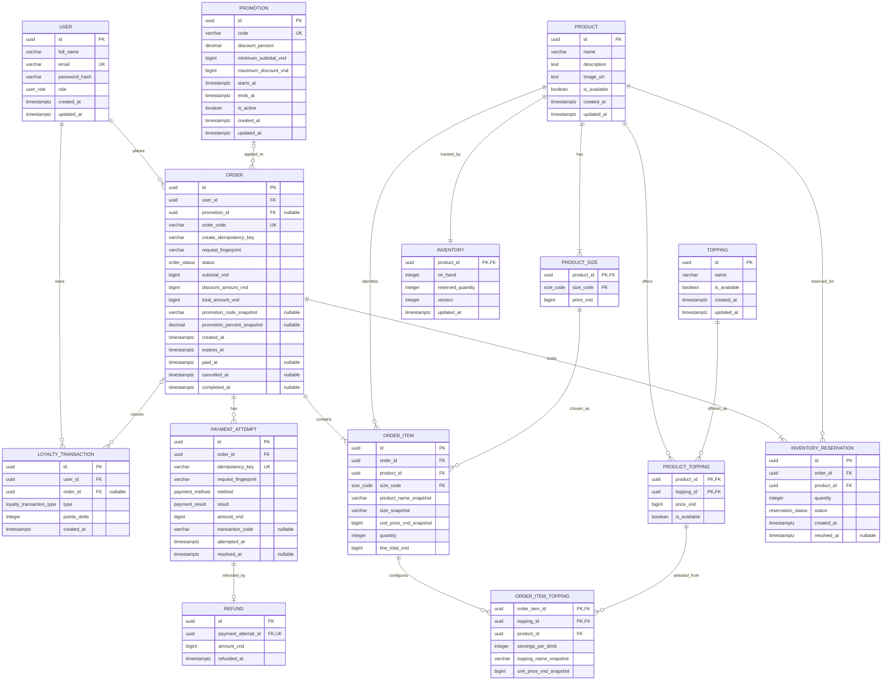

# BrewLite — Detailed ERD

**Bước:** 12 — Detailed ERD

**Trạng thái:** Bản thiết kế chi tiết để nhóm review; chưa được duyệt và chưa phải Prisma schema hay migration.

**Cơ sở:** [ERD sơ bộ](ERD_PRELIMINARY.md), [SRS](SRS.md), [Business Rules](BUSINESS_RULES.md), [Architecture](ARCHITECTURE.md), [phân công nhóm](TEAM_ASSIGNMENTS.md).

**Phụ trách:** Hưng thiết kế; Phát review khả năng tích hợp Prisma schema/migration; chủ module review phần dữ liệu tương ứng.

## 1. Phạm vi và quy ước

Tài liệu cụ thể hóa bảng, cột, kiểu dữ liệu PostgreSQL, nullability, khóa và ràng buộc
cho dữ liệu lưu trong database. Những lựa chọn chưa được nguồn xác định được đánh dấu là
**đề xuất cần nhóm chốt**. Tài liệu không tạo Prisma model, migration hoặc dữ liệu thật.

- Tiền dùng `BIGINT` theo đơn vị đồng Việt Nam (VND), tránh số thực và đáp ứng quy tắc làm tròn đến đồng.
- Thời gian dùng `TIMESTAMPTZ`, lưu và so sánh theo UTC.
- ID dùng `UUID`.
- `PK` là khóa chính, `FK` là khóa ngoại, `UK` là duy nhất. Khóa ghép được ghi rõ.
- CUSTOMER và STAFF dùng chung bảng `USER`; không thêm ADMIN.
- Giỏ hàng được lưu trên trình duyệt theo SRS nên không có bảng `CART`.
- JWT/session không có bảng riêng vì cách lưu và thời hạn phiên chưa được đặc tả.

## 2. Sơ đồ quan hệ

## 3. Định nghĩa bảng và cột

### 3.1. `USER`

| Cột | Kiểu | Null | Khóa / mặc định | Ý nghĩa |
|---|---|---:|---|---|
| `id` | `UUID` | Không | PK | Định danh tài khoản. |
| `full_name` | `VARCHAR(120)` | Không | — | Họ tên đăng ký. |
| `email` | `VARCHAR(254)` | Không | Unique sau chuẩn hóa | Email đăng nhập. |
| `password_hash` | `VARCHAR(255)` | Không | — | Hash mật khẩu, không lưu mật khẩu gốc. |
| `role` | `user_role` | Không | `CUSTOMER` | `CUSTOMER` hoặc `STAFF`. |
| `created_at`, `updated_at` | `TIMESTAMPTZ` | Không | `now()` | Thời điểm tạo/cập nhật. |

Đề xuất unique index trên `lower(email)` để tránh email trùng khác hoa/thường.

### 3.2. `PRODUCT`, `PRODUCT_SIZE`

| Bảng / cột | Kiểu | Null | Khóa / mặc định | Ý nghĩa |
|---|---|---:|---|---|
| `PRODUCT.id` | `UUID` | Không | PK | Định danh đồ uống. |
| `PRODUCT.name` | `VARCHAR(160)` | Không | — | Tên sản phẩm. |
| `PRODUCT.description` | `TEXT` | Có | — | Mô tả. |
| `PRODUCT.image_url` | `TEXT` | Có | — | Đường dẫn ảnh. |
| `PRODUCT.is_available` | `BOOLEAN` | Không | `true` | Có thể mua hay không. |
| `PRODUCT.created_at`, `updated_at` | `TIMESTAMPTZ` | Không | `now()` | Thời điểm tạo/cập nhật. |
| `PRODUCT_SIZE.product_id` | `UUID` | Không | PK ghép, FK → `PRODUCT.id` | Sản phẩm. |
| `PRODUCT_SIZE.size_code` | `size_code` | Không | PK ghép | `S`, `M` hoặc `L`. |
| `PRODUCT_SIZE.price_vnd` | `BIGINT` | Không | — | Giá đầy đủ theo size. |

PK `PRODUCT_SIZE` là (`product_id`, `size_code`); giá không âm. Mỗi sản phẩm bán được cần
có size `S`, theo giá và lựa chọn mặc định nêu trong SRS.

### 3.3. `TOPPING`, `PRODUCT_TOPPING`

| Bảng / cột | Kiểu | Null | Khóa / mặc định | Ý nghĩa |
|---|---|---:|---|---|
| `TOPPING.id` | `UUID` | Không | PK | Định danh topping. |
| `TOPPING.name` | `VARCHAR(120)` | Không | — | Tên topping. |
| `TOPPING.is_available` | `BOOLEAN` | Không | `true` | Topping còn kinh doanh. |
| `TOPPING.created_at`, `updated_at` | `TIMESTAMPTZ` | Không | `now()` | Thời điểm tạo/cập nhật. |
| `PRODUCT_TOPPING.product_id` | `UUID` | Không | PK ghép, FK → `PRODUCT.id` | Món áp dụng topping. |
| `PRODUCT_TOPPING.topping_id` | `UUID` | Không | PK ghép, FK → `TOPPING.id` | Topping áp dụng. |
| `PRODUCT_TOPPING.price_vnd` | `BIGINT` | Không | — | Giá một phần topping cho món. |
| `PRODUCT_TOPPING.is_available` | `BOOLEAN` | Không | `true` | Topping có thể chọn cho món. |

PK `PRODUCT_TOPPING` là (`product_id`, `topping_id`); giá không âm. Lựa chọn 0 phần được
biểu diễn bằng không có dòng trong `ORDER_ITEM_TOPPING`; số phần lưu phải từ 1 đến 3.

### 3.4. `INVENTORY`

| Cột | Kiểu | Null | Khóa / mặc định | Ý nghĩa |
|---|---|---:|---|---|
| `product_id` | `UUID` | Không | PK, FK → `PRODUCT.id` | Một bản ghi tồn cho mỗi sản phẩm, dùng chung các size. |
| `on_hand` | `INTEGER` | Không | `0` | Lượng vật lý hiện có. |
| `reserved_quantity` | `INTEGER` | Không | `0` | Lượng đang giữ cho đơn chưa thanh toán. |
| `version` | `INTEGER` | Không | `0` | Version để kiểm soát cập nhật đồng thời. |
| `updated_at` | `TIMESTAMPTZ` | Không | `now()` | Thời điểm cập nhật. |

CHECK: `on_hand >= 0`, `reserved_quantity >= 0`, `reserved_quantity <= on_hand`,
`version >= 0`. Tồn khả dụng là `on_hand - reserved_quantity`.

### 3.5. `PROMOTION`

| Cột | Kiểu | Null | Khóa / mặc định | Ý nghĩa |
|---|---|---:|---|---|
| `id` | `UUID` | Không | PK | Định danh khuyến mãi. |
| `code` | `VARCHAR(64)` | Không | Unique sau chuẩn hóa | Mã khách nhập. |
| `discount_percent` | `NUMERIC(5,2)` | Không | — | Phần trăm giảm. |
| `minimum_subtotal_vnd` | `BIGINT` | Không | — | Tổng tiền tối thiểu trước giảm. |
| `maximum_discount_vnd` | `BIGINT` | Không | — | Mức giảm tối đa. |
| `starts_at`, `ends_at` | `TIMESTAMPTZ` | Không | — | Thời gian hiệu lực. |
| `is_active` | `BOOLEAN` | Không | `true` | Cờ bật/tắt mã. |
| `created_at`, `updated_at` | `TIMESTAMPTZ` | Không | `now()` | Thời điểm tạo/cập nhật. |

CHECK dự kiến: `0 < discount_percent <= 100`, ngưỡng/mức giảm không âm và
`ends_at > starts_at`. Backend tính theo BR-09, làm tròn xuống đến đồng và áp dụng mức giảm
tối đa. Kiểu dữ liệu và việc bắt buộc các giá trị này là lựa chọn cần nhóm xác nhận.

### 3.6. `ORDER`

| Cột | Kiểu | Null | Khóa / mặc định | Ý nghĩa |
|---|---|---:|---|---|
| `id` | `UUID` | Không | PK | Định danh đơn. |
| `user_id` | `UUID` | Không | FK → `USER.id` | Chủ đơn. |
| `promotion_id` | `UUID` | Có | FK → `PROMOTION.id` | Mã đã áp dụng, nếu có. |
| `order_code` | `VARCHAR(32)` | Không | UK | Mã hiển thị. |
| `create_idempotency_key` | `VARCHAR(128)` | Không | UK cùng `user_id` | Khóa chống tạo đơn trùng. |
| `request_fingerprint` | `CHAR(64)` | Không | — | SHA-256 yêu cầu đã chuẩn hóa. |
| `status` | `order_status` | Không | `PENDING` | Trạng thái đơn hiện tại. |
| `subtotal_vnd` | `BIGINT` | Không | — | Tổng các dòng trước giảm. |
| `discount_amount_vnd` | `BIGINT` | Không | `0` | Số tiền giảm đã chốt. |
| `total_amount_vnd` | `BIGINT` | Không | — | Tiền phải trả sau giảm. |
| `promotion_code_snapshot` | `VARCHAR(64)` | Có | — | Mã tại thời điểm tạo đơn. |
| `promotion_percent_snapshot` | `NUMERIC(5,2)` | Có | — | Phần trăm giảm đã áp dụng. |
| `created_at` | `TIMESTAMPTZ` | Không | `now()` | Thời điểm tạo. |
| `expires_at` | `TIMESTAMPTZ` | Không | — | Hạn thanh toán, 15 phút sau tạo theo BR-16. |
| `paid_at`, `cancelled_at`, `completed_at` | `TIMESTAMPTZ` | Có | — | Thời điểm đạt trạng thái tương ứng. |

UNIQUE (`user_id`, `create_idempotency_key`). Cùng khóa nhưng fingerprint khác phải bị
từ chối. Tổng tiền không âm, `total_amount_vnd > 0`, giảm không vượt subtotal và
`expires_at > created_at`. Mỗi đơn phải có ít nhất một dòng; kiểm tra trong service/transaction.

### 3.7. `ORDER_ITEM`, `ORDER_ITEM_TOPPING`

| Bảng / cột | Kiểu | Null | Khóa / mặc định | Ý nghĩa |
|---|---|---:|---|---|
| `ORDER_ITEM.id` | `UUID` | Không | PK | Dòng hàng. |
| `ORDER_ITEM.order_id` | `UUID` | Không | FK → `ORDER.id` | Đơn chứa dòng hàng. |
| `ORDER_ITEM.product_id` | `UUID` | Không | FK → `PRODUCT.id` | Sản phẩm đã chọn. |
| `ORDER_ITEM.size_code` | `size_code` | Không | FK ghép → `PRODUCT_SIZE` | Size đã chọn. |
| `ORDER_ITEM.product_name_snapshot` | `VARCHAR(160)` | Không | — | Tên món lúc chốt. |
| `ORDER_ITEM.size_snapshot` | `VARCHAR(16)` | Không | — | Nhãn size lúc chốt. |
| `ORDER_ITEM.unit_price_vnd_snapshot` | `BIGINT` | Không | — | Giá size chưa gồm topping. |
| `ORDER_ITEM.quantity` | `INTEGER` | Không | — | Số ly. |
| `ORDER_ITEM.line_total_vnd` | `BIGINT` | Không | — | Thành tiền dòng đã chốt, gồm topping. |
| `ORDER_ITEM_TOPPING.order_item_id` | `UUID` | Không | PK ghép, FK → `ORDER_ITEM.id` | Dòng hàng được cấu hình. |
| `ORDER_ITEM_TOPPING.product_id` | `UUID` | Không | FK ghép | Dùng kiểm tra topping thuộc đúng món. |
| `ORDER_ITEM_TOPPING.topping_id` | `UUID` | Không | PK ghép, FK ghép → `PRODUCT_TOPPING` | Topping hợp lệ của món. |
| `ORDER_ITEM_TOPPING.servings_per_drink` | `SMALLINT` | Không | — | Số phần trên mỗi ly. |
| `ORDER_ITEM_TOPPING.topping_name_snapshot` | `VARCHAR(120)` | Không | — | Tên topping lúc chốt. |
| `ORDER_ITEM_TOPPING.unit_price_vnd_snapshot` | `BIGINT` | Không | — | Giá một phần đã chốt. |

`PRODUCT_SIZE` có khóa (`product_id`, `size_code`); `ORDER_ITEM` tham chiếu cặp đó.
Để kiểm tra topping khớp món, đặt UNIQUE (`id`, `product_id`) trên `ORDER_ITEM`, FK
(`order_item_id`, `product_id`) từ `ORDER_ITEM_TOPPING` tới cặp này, đồng thời FK
(`product_id`, `topping_id`) tới `PRODUCT_TOPPING`. PK dòng topping là
(`order_item_id`, `topping_id`).

CHECK: số ly từ 1–99; topping từ 1–3 phần (không lưu hàng có số phần 0); giá và thành tiền
không âm. Backend tính tổng dòng và tổng đơn trong transaction; tổng dòng phải bằng
`ORDER.subtotal_vnd`.

### 3.8. `INVENTORY_RESERVATION`

| Cột | Kiểu | Null | Khóa / mặc định | Ý nghĩa |
|---|---|---:|---|---|
| `id` | `UUID` | Không | PK | Định danh lần giữ. |
| `order_id` | `UUID` | Không | FK → `ORDER.id` | Đơn giữ hàng. |
| `product_id` | `UUID` | Không | FK → `PRODUCT.id` | Sản phẩm; tồn dùng chung các size. |
| `quantity` | `INTEGER` | Không | — | Tổng ly sản phẩm trong đơn. |
| `status` | `reservation_status` | Không | `HELD` | `HELD`, `RELEASED`, `CONSUMED`, `RETURNED`. |
| `created_at` | `TIMESTAMPTZ` | Không | `now()` | Thời điểm giữ. |
| `resolved_at` | `TIMESTAMPTZ` | Có | — | Thời điểm giải phóng/tiêu thụ/hoàn. |

UNIQUE (`order_id`, `product_id`); `quantity > 0`. Mỗi dòng tổng hợp một sản phẩm trong
đơn, kể cả sản phẩm nằm ở nhiều size. Cập nhật reservation và inventory cùng transaction.

### 3.9. `PAYMENT_ATTEMPT`, `REFUND`

| Bảng / cột | Kiểu | Null | Khóa / mặc định | Ý nghĩa |
|---|---|---:|---|---|
| `PAYMENT_ATTEMPT.id` | `UUID` | Không | PK | Lần thử thanh toán. |
| `PAYMENT_ATTEMPT.order_id` | `UUID` | Không | FK → `ORDER.id` | Đơn được thanh toán. |
| `PAYMENT_ATTEMPT.idempotency_key` | `VARCHAR(128)` | Không | UK | Khóa chống xử lý lặp. |
| `PAYMENT_ATTEMPT.request_fingerprint` | `CHAR(64)` | Không | — | Dấu vân tay nội dung yêu cầu. |
| `PAYMENT_ATTEMPT.method` | `payment_method` | Không | — | `WALLET` hoặc `CARD`. |
| `PAYMENT_ATTEMPT.result` | `payment_result` | Không | `PENDING` | `PENDING`, `SUCCEEDED`, `FAILED`. |
| `PAYMENT_ATTEMPT.amount_vnd` | `BIGINT` | Không | — | Sao chép từ tổng đơn backend. |
| `PAYMENT_ATTEMPT.transaction_code` | `VARCHAR(64)` | Có | — | Mã giao dịch mock. |
| `PAYMENT_ATTEMPT.attempted_at` | `TIMESTAMPTZ` | Không | `now()` | Thời điểm bắt đầu. |
| `PAYMENT_ATTEMPT.resolved_at` | `TIMESTAMPTZ` | Có | — | Thời điểm có kết quả cuối. |
| `REFUND.id` | `UUID` | Không | PK | Khoản hoàn mô phỏng. |
| `REFUND.payment_attempt_id` | `UUID` | Không | FK, UK → `PAYMENT_ATTEMPT.id` | Giao dịch được hoàn. |
| `REFUND.amount_vnd` | `BIGINT` | Không | — | Số tiền hoàn. |
| `REFUND.refunded_at` | `TIMESTAMPTZ` | Không | `now()` | Thời điểm ghi nhận hoàn. |

Một đơn chỉ có tối đa một payment attempt `SUCCEEDED`: partial unique index trên
`PAYMENT_ATTEMPT(order_id) WHERE result = 'SUCCEEDED'`. Mỗi attempt có tối đa một refund;
chỉ hoàn attempt thành công khi STAFF hủy đơn PAID hợp lệ. Kết quả gọi lại cùng idempotency
key được đọc lại từ dữ liệu đã lưu.

### 3.10. `LOYALTY_TRANSACTION`

| Cột | Kiểu | Null | Khóa / mặc định | Ý nghĩa |
|---|---|---:|---|---|
| `id` | `UUID` | Không | PK | Phát sinh điểm. |
| `user_id` | `UUID` | Không | FK → `USER.id` | Chủ điểm. |
| `order_id` | `UUID` | Có | FK → `ORDER.id` | Đơn tạo/đảo điểm. |
| `type` | `loyalty_transaction_type` | Không | — | `EARN` hoặc `REVERSAL`. |
| `points_delta` | `INTEGER` | Không | — | EARN dương, REVERSAL âm. |
| `created_at` | `TIMESTAMPTZ` | Không | `now()` | Thời điểm phát sinh. |

UNIQUE (`order_id`, `type`); EARN có điểm dương, REVERSAL có điểm âm. Chỉ ghi EARN khi
`floor(total_amount_vnd / 10000) > 0`; đảo đúng số điểm EARN đã lưu. Số dư là tổng
`points_delta` của người dùng.

### 3.11. Enum

| Enum | Giá trị |
|---|---|
| `user_role` | `CUSTOMER`, `STAFF` |
| `size_code` | `S`, `M`, `L` |
| `order_status` | `PENDING`, `PAYMENT_FAILED`, `PAID`, `PREPARING`, `READY`, `COMPLETED`, `CANCELLED` |
| `payment_method` | `WALLET`, `CARD` |
| `payment_result` | `PENDING`, `SUCCEEDED`, `FAILED` |
| `reservation_status` | `HELD`, `RELEASED`, `CONSUMED`, `RETURNED` |
| `loyalty_transaction_type` | `EARN`, `REVERSAL` |

## 4. Chỉ mục và hành vi xóa

- `USER`: unique index trên `lower(email)`.
- `PRODUCT_SIZE`: PK (`product_id`, `size_code`).
- `PRODUCT_TOPPING`: PK (`product_id`, `topping_id`).
- `ORDER`: unique `order_code`; unique (`user_id`, `create_idempotency_key`).
- `ORDER`: index (`user_id`, `created_at`) cho lịch sử đơn; `PROMOTION` có thể thêm index
  trên (`is_active`, `starts_at`, `ends_at`) cho tra cứu mã đang hiệu lực.
- `ORDER_ITEM`: index (`order_id`); unique (`id`, `product_id`) cho FK ghép.
- `ORDER_ITEM_TOPPING`: PK (`order_item_id`, `topping_id`); FK ghép như mục 3.7.
- `PROMOTION`: unique index trên mã đã chuẩn hóa.
- `PAYMENT_ATTEMPT`: unique `idempotency_key`; index (`order_id`, `attempted_at`); partial
  unique `order_id` cho kết quả `SUCCEEDED`.
- `REFUND`: unique `payment_attempt_id`.
- `INVENTORY_RESERVATION`: unique (`order_id`, `product_id`).
- `LOYALTY_TRANSACTION`: unique (`order_id`, `type`); index (`user_id`, `created_at`).

Không cascade xóa đơn sang dòng hàng, thanh toán, refund, reservation hoặc ledger điểm.
Đề xuất RESTRICT các FK lịch sử và vô hiệu hóa thay vì xóa sản phẩm, size, topping, mã
khuyến mãi đã dùng. Chính sách xóa/vô hiệu hóa tài khoản cần nhóm chốt; đề xuất không cho
xóa tài khoản có đơn liên quan.

## 5. Giao dịch và quy tắc toàn vẹn

- **Tạo đơn:** backend kiểm tra sản phẩm, size/topping, số lượng, mã giảm, giá và tồn;
  tạo đơn, dòng hàng và reservation; tăng `reserved_quantity` và `version` trong cùng
  transaction. Hạn thanh toán là 15 phút theo BR-16.
- **Hủy/hết hạn trước thanh toán:** chỉ đơn `PENDING` hoặc `PAYMENT_FAILED`; chuyển sang
  `CANCELLED`, reservation `HELD` → `RELEASED`, giảm lượng giữ đúng một lần.
- **Thanh toán thành công:** ghi attempt thành công; đơn sang `PAID`; reservation
  `HELD` → `CONSUMED`; giảm `on_hand` và `reserved_quantity` cùng lượng để tồn khả dụng
  không bị trừ lần nữa. Cộng điểm theo BR-28. Các cập nhật phải nguyên tử.
- **Thanh toán thất bại:** đơn sang `PAYMENT_FAILED`, vẫn giữ reservation trong thời hạn.
- **Hủy đơn PAID trước khi pha:** STAFF tạo refund mock, đổi đơn sang `CANCELLED`, reservation
  `CONSUMED` → `RETURNED`, hoàn tồn và đảo số điểm đã cộng; mỗi hiệu ứng đúng một lần.
- **Đồng thời:** cập nhật inventory theo `version`; nếu version không khớp thì rollback và
  xử lý như tranh chấp tồn kho, không nhận đơn vượt khả dụng.

Đây là ràng buộc thiết kế cần chủ module review; không thay thế API contract, State Machine
hoặc kiểm thử đồng thời.

## 6. Giả định cần nhóm chốt trước Prisma/migration

1. Giá size được mô hình là giá đầy đủ theo từng size/sản phẩm, không phải giá S cộng phụ thu.
2. Giá topping được mô hình theo cặp sản phẩm–topping; phạm vi dùng chung/giới hạn theo món
   chưa có quyết định nguồn.
3. Không thêm giới hạn lượt dùng khuyến mãi vì Business Rules chưa quy định.
4. Mô hình tiêu thụ tồn vật lý khi đơn sang PAID sau khi đã giữ tồn khả dụng lúc tạo đơn;
   chủ Inventory/Orders cần xác nhận cách diễn giải này.
5. Khóa tạo đơn có phạm vi duy nhất theo người dùng; khóa thanh toán duy nhất toàn bảng.
   Chủ API cần chốt phạm vi khóa và cách chuẩn hóa fingerprint.
6. Unique email và mã khuyến mãi không phân biệt hoa/thường được đề xuất bằng chuẩn hóa/index.
7. Chính sách xóa tài khoản/danh mục và phản hồi khi mock refund lỗi chưa được nguồn xác định.

## 7. Truy vết yêu cầu và review

| Nguồn | Thiết kế liên quan |
|---|---|
| SRS UC-01–03 | `USER`, role; session không có bảng riêng vì chưa chốt. |
| SRS UC-04–05, BR-01/03/05 | Product, size, topping, snapshot và giá chốt trên dòng đơn. |
| SRS UC-08, BR-08–12 | `PROMOTION`, snapshot giảm giá trong `ORDER`. |
| SRS UC-09, BR-13–20 | `ORDER`, dòng hàng, inventory, reservation, idempotency. |
| SRS UC-10/11, BR-21–27 | Payment attempts, trạng thái đơn và refund mock. |
| SRS UC-14/18, BR-28/32 | Ledger điểm, hoàn tồn và khoản hoàn. |
| SRS UC-15–18, BR-29–34 | Role STAFF và trạng thái đơn. |

- Hưng review mô hình tổng thể, Products, giá và ERD.
- Khoa review User/role, Inventory và concurrency.
- Huy review Promotion, loyalty và đảo điểm.
- Phát review Order, reservation, trạng thái, idempotency và khả năng triển khai Prisma.
- Thắng review payment, refund mock và idempotency.

Sau khi nhóm chốt mục 6 và review schema, Phát có thể ánh xạ sang Prisma schema/migration.
Tài liệu này chưa chứng minh schema, migration hoặc database đã được triển khai/duyệt.

## 8. Ánh xạ thực thể tối thiểu của đề

Đối chiếu mục 12.2 của đề VER 1.0 ngày 13/10/2026. Bảng này giải thích bản thiết kế hiện có, không thay cấu trúc bảng/cột hoặc khẳng định đã được thầy chấp nhận. Các quyết định nhóm xem [REQUIREMENTS_DECISIONS.md](REQUIREMENTS_DECISIONS.md).

| Thực thể / trường trong đề | Thiết kế hiện tại | Điều kiện giữ đủ ý nghĩa |
| --- | --- | --- |
| Product: id, name, price, imageUrl, stock | PRODUCT; giá trong PRODUCT_SIZE; tồn trong INVENTORY. | Giá menu size S và giá chọn S/M/L phải xác định được; stock là on_hand − reserved_quantity. Cần review tách bảng với yêu cầu thực thể tối thiểu, không tự coi thiếu trường là đã đáp ứng. |
| User: id, email, passwordHash, loyaltyPoints | USER và LOYALTY_TRANSACTION. | Số điểm là tổng points_delta; tài khoản mới 0 điểm, cộng sau PAID. Đề có trường loyaltyPoints nhưng USER hiện chưa lưu trường đó; nếu cần đúng trường theo đề, nhóm phải cập nhật bản thiết kế sau review. |
| Order: id, userId, status, total, createdAt | ORDER.id, user_id, status, total_amount_vnd, created_at. | Ánh xạ tên rõ ràng; giữ trạng thái theo sơ đồ đề, tiền nguyên VND. |
| OrderItem: id, orderId, productId, size, qty, lineTotal | ORDER_ITEM.id, order_id, product_id, size_code, quantity, line_total_vnd. | Bảo toàn cấu hình và snapshot; không nhầm quantity số ly với số phần topping. |
| Payment: id, orderId, idempotencyKey, amount, method | PAYMENT_ATTEMPT.id, order_id, idempotency_key, amount_vnd, method. | Một lần thử là một giao dịch mock; chống xử lý trùng, lấy tiền từ đơn. REFUND là phần chi tiết bổ sung cho hủy PAID. |

Giá size đầy đủ hiện có có thể biểu diễn giá cơ bản size S cộng phụ thu bằng phép ánh xạ; chưa thay mô hình sang base price/surcharge nếu chưa chốt bản ERD chính. Tồn/điểm tách bảng cũng cần review, không chỉ đổi tên để tuyên bố đáp ứng đề. Không có migration hoặc Prisma schema được sửa trong lần cập nhật này.
