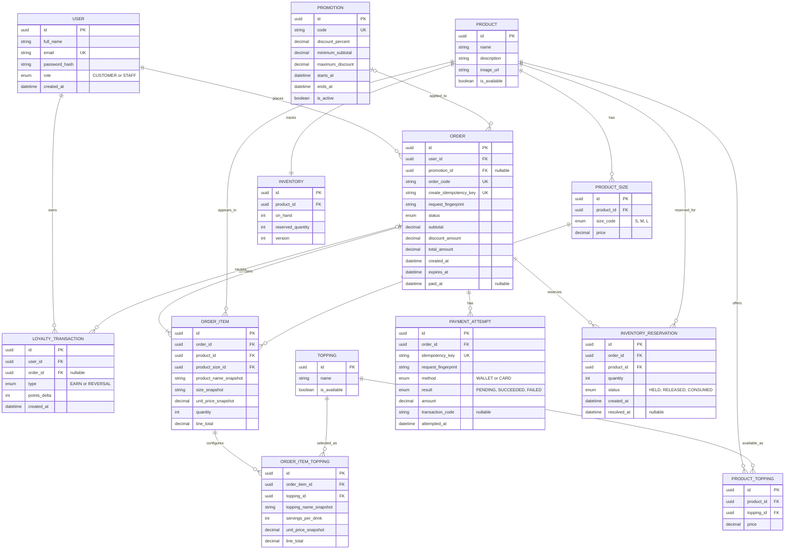

# BrewLite — ERD sơ bộ

**Bước:** 9 — Preliminary ERD

**Trạng thái:** Bản nháp để nhóm review; chưa được duyệt và chưa phải Prisma schema.

**Nguồn:** [Project Scope](PROJECT_SCOPE.md), [SRS](SRS.md), [Business Rules](BUSINESS_RULES.md), [Architecture](ARCHITECTURE.md), cập nhật 11/10/2026.

## 1. Mục đích và giới hạn

Sơ đồ xác định các thực thể nghiệp vụ chính và quan hệ cần có để hỗ trợ tài khoản,
sản phẩm, đơn hàng, tồn kho, thanh toán mô phỏng, khuyến mãi và điểm thưởng.
Đây là mô hình khái niệm ban đầu; kiểu dữ liệu, nullability, khóa ngoại, hành vi xóa,
chỉ mục và chiến lược migration sẽ được chốt ở Detailed ERD.

Các tài liệu nguồn được ghi là cần nhóm review. Những quyết định chưa có trong nguồn
được liệt kê ở mục 4 thay vì coi là quy tắc đã duyệt.

## 2. Sơ đồ quan hệ

Sơ đồ dùng ký pháp ERD Crow’s Foot: `||` là đúng một, `o|` là không hoặc một,
`o{` là không hoặc nhiều, `|{` là một hoặc nhiều. PK là khóa chính; FK là khóa ngoại.

## 3. Ý nghĩa các nhóm dữ liệu

- **Tài khoản:** `USER.role` phân biệt CUSTOMER và STAFF theo phạm vi hiện tại. Không
  có vai trò ADMIN trong sơ đồ.
- **Menu:** `PRODUCT_SIZE` giữ giá theo size; `PRODUCT_TOPPING` biểu diễn topping được
  cung cấp cho sản phẩm và giá topping. Cấu trúc này giả định giá là theo sản phẩm–size
  và theo sản phẩm–topping cho đến khi nhóm chốt quy tắc giá.
- **Đơn hàng:** `ORDER_ITEM` và `ORDER_ITEM_TOPPING` lưu cấu hình cùng ảnh chụp tên,
  size và giá để lịch sử không đổi khi menu thay đổi. `PROMOTION` có thể không được áp
  dụng; giá trị giảm đã chốt vẫn lưu trên đơn.
- **Thanh toán:** mỗi lần thử là một `PAYMENT_ATTEMPT`; khóa idempotency và dấu vân tay
  nội dung hỗ trợ nhận diện yêu cầu lặp. Số tiền lấy từ `ORDER.total_amount` ở backend.
- **Tồn kho:** `INVENTORY` quản lý tồn theo sản phẩm, dùng chung cho mọi size. Một dòng
  `INVENTORY_RESERVATION` cho mỗi cặp đơn–sản phẩm ghi lượng giữ và kết quả xử lý để
  việc hoàn/tiêu thụ lượng giữ có thể được kiểm soát một lần.
- **Điểm thưởng:** `LOYALTY_TRANSACTION` là sổ phát sinh cộng/đảo điểm; số dư có thể
  tính từ tổng `points_delta`. Cần ràng buộc để không ghi nhận cùng một loại thay đổi
  điểm cho cùng đơn nhiều lần.
- **Giỏ hàng:** không nằm trong ERD database ở bản này vì SRS quy định lưu trên trình
  duyệt. Đơn hàng lưu dữ liệu chốt khi khách xác nhận tạo đơn.

## 4. Giả định và câu hỏi cần nhóm chốt

1. **Giá size và topping:** SRS chưa xác định size là phụ thu hay giá độc lập theo từng
   sản phẩm; cũng chưa xác định topping dùng chung hay giới hạn theo món. Cần chốt trước
   Detailed ERD. Sơ đồ hiện dùng giá riêng trên quan hệ sản phẩm–size và sản phẩm–topping.
2. **Khuyến mãi:** các trường phần trăm, mức tối thiểu và mức giảm tối đa có trong
   Business Rules; tính bắt buộc, miền giá trị, timezone và chính sách mã trùng cần chốt.
   Số lượt dùng không được thêm vì chưa có quy tắc nguồn.
3. **Tồn kho:** mô hình dùng `on_hand`, `reserved_quantity`, `version` và các reservation
   theo đơn–sản phẩm để phác thảo giữ/hoàn kho. Nhóm cần xác nhận chính xác thời điểm
   reservation chuyển sang consumed khi thanh toán/pha chế.
4. **Điểm:** cần xác nhận có lưu số dư trên USER như cache hay luôn tính từ ledger. Sơ đồ
   hiện chọn ledger làm nguồn phát sinh để hỗ trợ đảo điểm và chống cộng lặp.
5. **Lịch sử khi xóa dữ liệu danh mục:** cần chốt chính sách xóa/ẩn sản phẩm, size,
   topping và khuyến mãi. Các snapshot giữ thông tin đơn lịch sử, nhưng hành vi FK khi
   xóa chưa được quyết định.
6. **Phiên đăng nhập:** JWT/session và thời hạn phiên chưa được đặc tả đủ; không đưa
   bảng session/token vào ERD bản này.

## 5. Ràng buộc dự kiến để xem xét ở Detailed ERD

- `USER.email`, `INVENTORY.product_id`, `PRODUCT_SIZE(product_id, size_code)`,
  `PRODUCT_TOPPING(product_id, topping_id)`, `PROMOTION.code` và `ORDER.order_code`
  cần duy nhất theo phạm vi phù hợp.
- Khóa tạo đơn chống lặp cần có phạm vi duy nhất đã thống nhất (toàn hệ thống hoặc
  theo người dùng). `PAYMENT_ATTEMPT.idempotency_key` cần duy nhất.
- `INVENTORY_RESERVATION(order_id, product_id)` nên duy nhất; ledger điểm cần ràng
  buộc không lặp cùng loại phát sinh cho một đơn, nếu nghiệp vụ chốt tối đa một lần
  cộng và một lần đảo mỗi đơn.
- `ORDER_ITEM.quantity` nằm trong 1–99; `ORDER_ITEM_TOPPING.servings_per_drink`
  nằm trong 0–3 theo BR-03. Có thể chỉ lưu các topping có số phần lớn hơn 0.
- Giá, số tiền, tồn kho và số điểm không âm; `reserved_quantity <= on_hand` nếu nhóm
  chọn cách diễn giải hai cột này như lượng vật lý đã giữ.
- Mỗi đơn cần ít nhất một dòng hàng; kiểm tra này thường cần xử lý ở tầng nghiệp vụ hoặc
  transaction, không chỉ bằng một CHECK constraint đơn giản.
- Không suy ra hành vi cascade. Cần ưu tiên bảo toàn đơn, giao dịch và lịch sử điểm khi
  dữ liệu danh mục hoặc tài khoản bị ẩn/ngừng hoạt động.

## 6. Đầu vào cho bước tiếp theo

Bản chi tiết trường dữ liệu và ràng buộc được trình bày tại
[ERD_DETAILED.md](ERD_DETAILED.md). Hai sơ đồ đều là thiết kế đề xuất để nhóm review,
chưa phải Prisma schema hoặc database đã triển khai.

Chủ module cần rà soát các phần liên quan:

- Hưng: Products, giá size/topping và cấu trúc tổng thể.
- Khoa: User/role và Inventory.
- Phát: Order, order item, reservation, idempotency tạo đơn và khả năng triển khai schema.
- Thắng: Payment attempt và idempotency thanh toán.
- Huy: Promotion và loyalty ledger.

Đối chiếu bản này với User Stories, Acceptance Criteria và Use Case Description sau khi
các tài liệu đó được hoàn thiện. Không coi file ERD này là bằng chứng code, migration,
hoặc database đã được triển khai.
